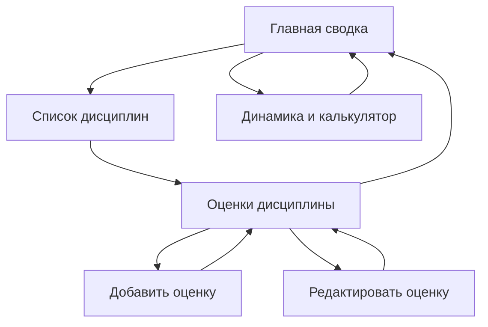

# Спринт 1. Анализ требований, сценарии и прототип интерфейса

**Цель:** согласовать назначение приложения, пользовательские сценарии, экраны и правила работы с оценками.

## 1. Паспорт приложения

**Название:** «Личный кабинет успеваемости студента».

**Назначение:** мобильное приложение позволяет студенту просматривать оценки, группировать их по дисциплинам, рассчитывать средний балл и отслеживать изменение успеваемости.

**Основной пользователь:** студент, самостоятельно ведущий журнал своих оценок.

### Состав главного экрана
- общий средний балл по всем внесённым оценкам;
- общее количество оценок;
- краткий список дисциплин со средним баллом;
- переход к журналу оценок выбранной дисциплины.

## 2. Перечень экранов

| Экран | Назначение | Основные элементы |
|---|---|---|
| Главная сводка | Быстро оценить успеваемость | Средний балл, количество оценок, карточки дисциплин |
| Список дисциплин | Выбрать предмет | Название дисциплины, средний балл |
| Оценки дисциплины | Просмотреть журнал | Оценка, дата, тип работы, комментарий |
| Добавление/редактирование оценки | Внести или исправить запись | Дисциплина, значение, дата, тип работы, комментарий |
| Динамика/калькулятор | Анализировать результат | Средний балл по периодам, целевой средний балл |

## 3. Пользовательские сценарии и критерии приёмки

### Сценарий 1. Просмотр общей сводки
**Действия:** студент открывает приложение и переходит на главный экран.

**Критерии приёмки:**
- отображается общий средний балл по всем внесённым оценкам;
- отображается количество оценок;
- показана краткая сводка по дисциплинам;
- если оценок нет, вместо числа отображается понятное пустое состояние, деление на ноль не выполняется.

### Сценарий 2. Просмотр оценок по дисциплине
**Действия:** студент выбирает дисциплину из списка.

**Критерии приёмки:**
- открывается журнал только выбранной дисциплины;
- каждая запись содержит значение, дату и тип работы;
- комментарий показывается, если он заполнен;
- при отсутствии оценок отображается сообщение, а не пустой экран.

### Сценарий 3. Добавление оценки
**Действия:** студент выбирает добавление оценки, указывает дисциплину, значение, дату и тип работы, при необходимости вводит комментарий и сохраняет запись.

**Критерии приёмки:**
- обязательные поля проверяются до сохранения;
- значение оценки проверяется на допустимый диапазон 2–5;
- после сохранения запись появляется в журнале выбранной дисциплины;
- некорректная запись не сохраняется, пользователю показывается понятная ошибка.

### Сценарий 4. Редактирование и удаление оценки
**Действия:** студент открывает существующую запись, меняет данные или удаляет её.

**Критерии приёмки:**
- изменения сохраняются и отображаются в журнале;
- удаление убирает запись из журнала;
- после изменения или удаления средний балл пересчитывается;
- пользователь может отличить отмену действия от успешного сохранения.

### Сценарий 5. Фильтрация оценок
**Действия:** студент выбирает дисциплину, период или тип работы в фильтрах.

**Критерии приёмки:**
- список содержит только записи, соответствующие выбранным условиям;
- сброс фильтров возвращает полный список;
- пустой результат сопровождается понятным сообщением.

### Сценарий 6. Просмотр динамики
**Действия:** студент открывает экран динамики успеваемости.

**Критерии приёмки:**
- средние баллы сравниваются по периодам;
- отображаемые значения рассчитаны по фактическим оценкам;
- если данных недостаточно, приложение сообщает об этом.

### Сценарий 7. Расчёт целевого результата
**Действия:** студент задаёт желаемый средний балл.

**Критерии приёмки:**
- приложение рассчитывает требуемую следующую оценку;
- если цель нельзя достичь одной следующей оценкой в диапазоне 2–5, показывается объяснение;
- результат не округляется так, чтобы скрыть невозможность достижения цели.

## 4. Схема переходов



## 5. Текстовые прототипы экранов

### Главная сводка
```text
┌────────────────────────────────┐
│ Успеваемость                   │
│                                │
│ Средний балл       4,35        │
│ Всего оценок       12          │
│                                │
│ Дисциплины                     │
│ Математика         4,50   >    │
│ История            4,00   >    │
│ Программирование   4,60   >    │
│                                │
│ [Дисциплины] [Динамика]        │
└────────────────────────────────┘
```

### Журнал дисциплины
```text
┌────────────────────────────────┐
│ < Математика                   │
│ Средний балл: 4,50             │
│                                │
│ 5  Контрольная    12.09.2026   │
│ 4  Практическая   19.09.2026   │
│ 5  Ответ          26.09.2026   │
│                                │
│ [+ Добавить оценку]            │
│ [Фильтры]                      │
└────────────────────────────────┘
```

### Форма оценки
```text
┌────────────────────────────────┐
│ Новая оценка                   │
│ Дисциплина: [Математика     v] │
│ Оценка:      [5              ] │
│ Дата:        [24.11.2026     ] │
│ Тип работы:  [Контрольная   v] │
│ Комментарий: [               ] │
│                                │
│ [Отмена]          [Сохранить]  │
└────────────────────────────────┘
```

*Значения в макетах приведены как пример, это не реальные данные пользователя.*

## 6. Правила предметной области
- базовая система оценивания — пятибалльная, допустимые значения: целые числа от 2 до 5;
- средний балл — среднее арифметическое всех оценок, одинаковый вес у каждой записи;
- общий средний балл считается по всем внесённым оценкам, а не как среднее средних по дисциплинам;
- при отсутствии оценок средний балл не рассчитывается, показывается «Нет оценок»;
- дата хранится в однозначном формате; в интерфейсе показывается локализованно;
- удаление дисциплины должно обрабатываться осознанно: вместе с оценками либо с запретом удаления при наличии оценок и предупреждением.

## 7. Распределение задач

| Роль | Задачи спринта 1 | Артефакт |
|---|---|---|
| Product Owner / аналитик | Назначение приложения, пользовательские сценарии, критерии приёмки, согласование требований | Паспорт, сценарии |
| Lead Developer | Состав экранов, схема навигации, технические решения и структура проекта | Схема экранов, архитектурные заметки |
| QA / DevOps | Проверка полноты сценариев, проверяемости критериев, подготовка тестовых примеров | Чек-лист приёмки |

## 8. Контрольная точка
Спринт считается выполненным, когда согласованы паспорт приложения, не менее пяти пользовательских сценариев с критериями приёмки, схема переходов, прототипы основных экранов и список задач команды.
